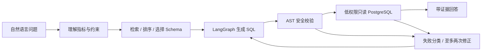

# InsightFlow · Enterprise Data Analysis Agent

面向可信合成业务数据库的本地分析 Agent：中文问题 → 指标与约束 →
相关 Schema 检索 → PostgreSQL SQL → 安全校验 → 只读查询 → 证据回答。
使用真实 LangGraph 工作流，支持有界 SQL 修正和 Session 内多轮追问。

当前实现覆盖受控中文指标，不是任意企业问题的通用 BI 系统。
仓库默认 Private；没有身份认证，不应将演示服务公开部署。

## 技术栈
Python 3.12（兼容要求 3.11+）、LangGraph、FastAPI、Pydantic、
PostgreSQL 16、psycopg 3、SQLGlot、pytest、httpx、可选官方 OpenAI-compatible SDK。
requirements.lock 锁定实际验收依赖；核心版本见最终验收报告。



## 环境准备与 Quick Start
Linux/WSL2、Python 3.11+（本次真实验证 3.12.3）、Git、Python venv、
PostgreSQL 16 服务及命令行。创建本项目两个新库需要管理员身份。
以下命令在仓库根目录执行，不要在旧 Go 项目目录操作。

```bash
git clone https://github.com/Loz888/insightflow-data-agent.git
cd insightflow-data-agent
python3 -m venv .venv
.venv/bin/python -m pip install -r requirements.lock
.venv/bin/python -m pip install --no-deps -e .
```

Private 仓库需先在自己的 GitHub CLI/凭据管理器完成登录。
不要把 Token 写进 clone URL。

首次新环境：管理员执行独立初始化脚本（Ubuntu 本机集群方式）：
```bash
sudo .venv/bin/python scripts/admin_bootstrap.py
./scripts/init_db.sh
```
脚本只创建 insightflow_dev、insightflow_test 与两个专用角色，
随机密码写到本地权限 0600 的 .env，不显示密码。
已有同名角色/数据库时会拒绝隐式接管或轮换；此时由管理员审计并配置 .env。
当前开发环境已初始化，不必再次创建。

已有数据库/远程 PostgreSQL：由管理员准备非超级用户 owner 和 reader，
在 .env 中配置 .env.example 列出的四个 DSN，再运行 init_db.sh。
读账号必须是 insightflow_reader、迁移账号必须是 insightflow_owner，
实际库名与角色权限会二次检查。不要把 owner DSN 用作查询 DSN。

init_db.sh 明确执行重置式合成数据装载，仅允许两个固定 InsightFlow 库；
重复执行不增加重复数据，但会覆盖本项目合成数据。不会操作 agent_runtime 数据库。
如果只想查询已有数据，不运行 Seeder。

## Mock Demo 与本地 API
```bash
./scripts/demo_mock.sh
./scripts/serve.sh
```
Demo 展示单表、JOIN、退款率、多轮、SQL 拦截、证据不足。
SQL 和结果来自真实测试 PostgreSQL，不需要真实模型 Key。

服务默认监听 127.0.0.1:8000：
```bash
curl http://127.0.0.1:8000/health
curl http://127.0.0.1:8000/schema
curl -X POST http://127.0.0.1:8000/chat   -H 'Content-Type: application/json'   -d '{"session_id":"demo-001","question":"2026年9月退款率是多少？"}'
curl -X POST http://127.0.0.1:8000/chat   -H 'Content-Type: application/json'   -d '{"session_id":"demo-001","question":"那华东地区呢？"}'
```
响应包含 answer、sql、tables_used、evidence、limitations、error、request_id、retries。
/health 是进程存活检查；未配置数据库时 /schema 返回空表、/chat 返回 503。
输入不合法返回 422；业务无法回答返回结构化澄清，证据为空。
退款率默认退款订单率；金额率需要明确询问，详见指标文档。

## 可选真实模型
默认关闭。先查看官方当前模型与价格；在本地设置 DEEPSEEK_API_KEY，
INSIGHTFLOW_ENABLE_LIVE=true、INSIGHTFLOW_DEEPSEEK_MODEL、
INSIGHTFLOW_INPUT_PRICE_PER_MILLION 与 INSIGHTFLOW_OUTPUT_PRICE_PER_MILLION。
价格必须是所选模型的保守 USD/百万 Token 上界，不自动下载/猜测价格。
通过自己的密钥管理方式配置，不把 Key 写进提交或命令截图。

```bash
./scripts/demo_deepseek.sh
```
仅跑一个问题。默认最多 3 次 API 调用、保守预留费用预算 0.05 USD；
配置最大 10 次/1 USD。每请求 15s 超时、SDK 内置重试关闭、输出上限 1024，
输入长度受限，关闭 thinking。请求前按 UTF-8 字节保守预留费用，不退款预留额度。
实际费用受价格配置准确性影响，不是平台计费限额或准确 Token 预测。
只有 API Usage 返回准确用量才记录 Token。未启用或缺 Key 输出 NOT RUN，
测试与总验收始终禁用真实调用。

## 测试与自动评测
```bash
./scripts/accept.sh
# 也可单独执行：
.venv/bin/python -m pytest -v
.venv/bin/python -m compileall -q src
.venv/bin/python -m pip check
.venv/bin/ruff check src tests scripts
```
测试要求专用 insightflow_test 和 reader/owner 配置；缺库直接失败，不 SKIP。
accept.sh 默认在 $HOME/.local/state/insightflow/acceptance 持久保存每次新建的外部报告目录（可用 INSIGHTFLOW_REPORT_BASE 指定），包含 acceptance.json/md、tests.json、
evaluation/{runs.jsonl,summary.json,failures.json,report.md} 和本地日志。
退出码区分工程失败 2、场景失败 1、全通过 0。日志不进入 Git。

参考结果重新构建是开发者显式操作（正常验收不会执行）：
```bash
set -a; source .env; set +a
.venv/bin/python scripts/build_ground_truth.py
```
请独立审核 ReferenceSQL，不用生成器输出替代 Ground Truth。

## 数据与文档
每库 100 customers、30 products、500 orders、1001 order_items、165 refunds。
所有金额 NUMERIC/Decimal，固定参考日期 2026-10-01 UTC。
多个退款先聚合，避免与订单明细 JOIN 重复计数。

- [架构和节点/工具职责](docs/architecture.md)
- [指标与退款口径](docs/metrics.md)
- [SQL 安全边界](docs/sql-security.md)
- [检索、上下文与短期记忆](docs/context-management.md)
- [评测方法](docs/evaluation.md)
- [实际 Mock 评测结果](reports/evaluation/report.md)
- [六阶段总验收](reports/FINAL_ACCEPTANCE.md)
- [Day1](reports/day1.md) / [Day2](reports/day2.md) / [Day3](reports/day3.md) /
  [Day4](reports/day4.md) / [Day5](reports/day5.md) / [Day6](reports/day6.md)

## 当前限制与后续计划
- 使用合成数据和固定中文指标策略，Mock 结果不是真实模型能力。
- 只允许受支持的 SELECT/函数/类型；复杂语法默认拒绝。
- 没有生产级安全、多租户隔离、不可信代码沙箱或通用因果推断。
- 无认证；Session ID 不是访问凭证；服务仅回环地址演示。
- Session 仅单进程内存，重启丢失；请求串行执行，不承诺高吞吐。
- Context Token 是估算；真实模型评测与计费本次 NOT RUN。
- 后续可扩展真实模型的小规模授权评测、更多指标/语言、持久 Session、
  认证与安全部署；这些不属于当前已实现功能。

简历草稿位于仓库外私人目录，不追踪个人教育/联系方式。
本项目独立于 Durable Coding Agent Runtime，不修改其代码或数据库。
