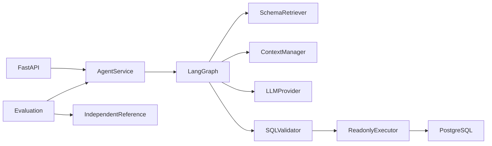

# InsightFlow · Enterprise Data Analysis Agent

## Project Overview
面向可信合成业务数据库的本地 Data Analysis Agent：
中文问题 → 指标与约束 → Schema Retrieval → PostgreSQL SQL → 严格校验 →
Reader 只读查询 → 带 SQL 证据的回答。使用真实 LangGraph 工作流。
仓库 Private，服务无认证，默认只监听回环地址。

## Why InsightFlow
自然语言 SQL 不能只“能执行”：还必须遵守指标口径、避免退款 JOIN 重复计数、
限制权限与资源，并用独立结果核对回答。项目把这些边界拆成可观察、可测试步骤。

## Core Features
| 状态 | 内容 |
| --- | --- |
| Implemented / Tested | 真实 LangGraph、PostgreSQL 五表、默认拒绝 SQL、Reader、只读事务、受限修正 |
| Implemented / Tested | 受控指标检索、Session 条件继承、历史预算、取消、隔离与故障分类 |
| Implemented / Tested | 30 案例独立评测、四模式消融、512 次 Mock 性能记录 |
| Experimental / NOT_RUN | DeepSeek 适配器已做本地 HTTP 测试，真实付费能力未运行 |
| Planned | 认证/安全部署、持久 Session、更广指标/数据源、受授权真实模型评测 |

## Architecture

[完整架构、状态和数据流图](docs/architecture.md) ·
[八章源码学习指南](docs/LEARNING_GUIDE.md)

## LangGraph Workflow
UnderstandQuestion → SelectSchema → GenerateSQL → ValidateSQL → ExecuteSQL → GenerateAnswer。
生成/校验/执行错误进入 ClassifyFailure，仅可恢复 SQL 错误最多修正两次。
权限、安全策略、超时、缺业务信息不盲目重试；模型 API 内部有限退避共用总请求预算。
节点返回结构化 State 更新，结果与错误路径都有自动化测试。

## Business Dataset
固定随机种子 20261020、参考时点 2026-10-01 UTC、CNY。
两个独立库 insightflow_dev / insightflow_test，不复用其他项目数据库。

| 表 | 行数 | 关系 / 口径 |
| --- | ---: | --- |
| customers | 100 | 四个地区 |
| products | 30 | 多类别、NUMERIC 标价 |
| orders | 500 | 客户 FK、paid/pending/cancelled、跨月 |
| order_items | 1001 | 订单/商品 FK、正数量与 NUMERIC 单价 |
| refunds | 165 | 成功/失败、部分/全额、同订单多次退款 |

七项指标见[metrics](docs/metrics.md)。退款订单率与退款金额率不同，
退款按订单日期归属，明细与退款分别聚合，避免 fan-out 重复计数。
“上月”固定为 2026-09，不使用机器当前日期。

## Environment / Quick Start
Linux/WSL2、Python 3.11+（本次 3.12.3）、Git、PostgreSQL 16 与客户端。
Private 仓库先在自己的 Git 凭据管理器/GitHub CLI 登录，不把 Token 放入 URL。

```bash
git clone https://github.com/Loz888/insightflow-data-agent.git
cd insightflow-data-agent
python3 -m venv .venv
.venv/bin/python -m pip install -r requirements.lock
.venv/bin/python -m pip install --no-deps -e .
```

首次本机新库，由管理员执行独立脚本：
```bash
sudo .venv/bin/python scripts/admin_bootstrap.py
./scripts/init_db.sh
```
随机密码只写本地权限 0600 的 .env，不显示、不提交。
已有同名角色/数据库会拒绝隐式接管；管理员审计后配置四个 DSN，
变量名见 .env.example。现有本机开发环境已初始化，无需再次建角色。

查询用 insightflow_reader（非 Owner/超级用户），迁移用 insightflow_owner。
init_db.sh 按排序应用全部迁移，并明确重置本项目两个库的合成数据；
重复不累加，但会覆盖合成数据。只想查询已有数据时不执行 Seeder。
管理员 DSN 不继承给服务/模型演示进程。

## Schema Retrieval
真实表/列/类型/FK 与人工指标定义组成目录；指标必要表、关键词和字段排名，
再补全必要 JOIN，只注入选择表。MaxSchemaItems 容不下就失败。
这是受控指标检索，未引入向量库。
[Recall@5 与消融](docs/retrieval-ablation.md) 使用独立参考 SQL 物理表标注，
没有用生成 SQL 作为正确答案。

## Context Management
同 Session 继承有效月份、地区和指标，新约束覆盖旧值。
历史最多 4 次成功回答，关键条件与非权威文本分开保存。
先裁剪旧工具输出，保留指标/时间/地区/币种；仍超预算则失败。
Token 估算为 ceil(UTF-8/3)，不是模型 tokenizer。
Session 仅单进程内存，重启丢失；全局串行更新，无长期记忆或租户授权。
[专项测试与消融](docs/context-evaluation.md) · [记忆边界](docs/context-management.md)

## SQL Security
SQLGlot PostgreSQL AST 默认拒绝多语句、DML/DDL、写 CTE、INTO、系统/未授权表、
高风险函数、复杂/不支持结构。真实字段与歧义校验后，普通函数绑定 pg_catalog，
防止同名重载。执行器总会再次校验。
独立 Reader 仅五表 SELECT，无未来表默认授权；强制只读事务、查询/锁/闲置超时、
计划成本、连接池、行数/字节预算。Prompt 无权提升权限。
取消传递到排队与真实 DB，取消后不存会话；在途同步模型 HTTP 仍受单请求超时约束。
[策略](docs/sql-security.md) · [最终安全与可靠性审查](docs/security-review.md)

## Mock Demo / API
```bash
./scripts/demo_mock.sh
./scripts/serve.sh
```
Demo 实际调用 Graph 和测试 PostgreSQL：单表、JOIN、退款率、多轮、
SQL 拒绝、无法回答，不按 QuestionID 打印固定答案。

默认 127.0.0.1:8000：
```bash
curl http://127.0.0.1:8000/health
curl http://127.0.0.1:8000/schema
curl -X POST http://127.0.0.1:8000/chat   -H 'Content-Type: application/json'   -d '{"session_id":"demo-001","question":"2026年9月退款率是多少？"}'
curl -X POST http://127.0.0.1:8000/chat   -H 'Content-Type: application/json'   -d '{"session_id":"demo-001","question":"那华东地区呢？"}'
```
响应含 answer/sql/tables_used/evidence/limitations/error/request_id/retries。
/health 是存活检查；无数据库 /schema 空目录、/chat 503。
非法输入 422；业务失败为结构化 error 与空 evidence；取消可报告 499。
没有认证，只能本地演示，SessionID 不是访问凭证。

## Real Model Configuration
**REAL_MODEL_EVALUATION = NOT_RUN**。不自动发起付费实验。
只有用户显式设置 INSIGHTFLOW_ENABLE_PAID_EVAL=1 且 INSIGHTFLOW_ENABLE_LIVE=true，
提供 Key、当前模型、保守价格与请求/Token/费用预留预算后才可运行。
Key 使用本地密钥管理，不提交或截图。默认最多 3 次 HTTP、1024 输出 Token、
15s 请求；总预算跨理解、生成、重试与案例共享。
429/网络/5xx 有限退避；SDK 自动重试关闭；未知 Usage 不记成零。
费用是保守预留与请求/Token 硬限制，不是精确计费限额。

```bash
./scripts/demo_deepseek.sh
# 12 个受控代表案例；未授权只生成 NOT_RUN，不进行 API 请求：
.venv/bin/python -m insightflow.evaluation.real_model --output /path/to/new-real-report
```
[真实模式方法和限制](docs/real-model-evaluation.md)

## Evaluation
30 案例：10 基础、10 JOIN/聚合、5 复杂指标、5 多轮。
ReferenceSQL 独立执行，正常验收不重建或改写 Ground Truth。
分别统计 Exact Match、SQL Execution、结果正确性、回答证据与场景成功。
数值用 Decimal 容差，多重集合保留重复行，NULL 不当零。
本阶段 Mock Full 为 30/30；这是受控规则测试，不是 DeepSeek 能力。

四模式真实记录：Baseline/RetrievalOnly 各 25/30，ContextOnly/Full 各 30/30，
10 个失败完整保留。Mock 不读 Schema 文本，不能证明真实 LLM 的 RAG 收益。
[评测方法](docs/evaluation.md) · [消融原始记录](evaldata/ablation/report.md) ·
[总验收](reports/FINAL_ACCEPTANCE.md)

## Performance
四档并发各 128 请求，共 512 唯一 RunID、512 成功。
这是 AgentService.run 的本机 Mock 测量，不是 HTTP/真实模型生产性能。
全局锁使排队增加，吞吐没有随并发线性扩展。P95/P99 小样本不代表 SLA。
[完整环境、阶段耗时与计划](docs/performance.md) · [原始记录](evaldata/performance/report.md)

## Tests / Acceptance
```bash
./scripts/accept.sh
.venv/bin/python -m pytest -v
.venv/bin/python -m compileall -q src
.venv/bin/python -m pip check
.venv/bin/ruff check src tests scripts
```
真实数据库测试缺库就失败，不能 SKIP 后称通过。
accept 默认在 $HOME/.local/state/insightflow/acceptance 持久保存每次新目录，
可用 INSIGHTFLOW_REPORT_BASE 指定；JSON/Markdown/逐案数据和本地日志均在 Git 外。
退出 0 全通过；1 评测场景失败但保留报告；2 工程故障。
真实付费开关在验收中移除，本地 SDK 测试只使用 HTTP MockTransport。

## Limitations
- 固定合成数据和受控中文指标，不是通用企业 BI 或因果推断系统。
- 仅受支持 SELECT/函数/类型；日级范围、季度、其他年份/币种等需要澄清。
- 无认证、生产安全保证、多租户隔离或不可信数据库管理员防御。
- 目录在启动时加载，Schema 变化需重新审查并重启/更新。
- 会话重启丢失、全局串行、没有跨主机执行或可靠长期记忆。
- 同步 LLM 在途取消受请求超时约束，数据库取消是尽力而为并保留超时。
- Token 估算与小样本性能有明确边界；真实模型评测未运行。

## Roadmap
更广业务指标、显式授权真实模型评测、认证与部署安全、持久 Session 等为 Planned。
不在本轮新增多 Agent、长期跨 Session 记忆、向量库、复杂前端或分布式平台。
本轮工程阶段完成后停止功能开发。

学习顺序：FastAPI Request → State → Nodes → Retrieval → Context →
Validator → Executor → Evaluation → Performance → 全链路，详见 LEARNING_GUIDE。
