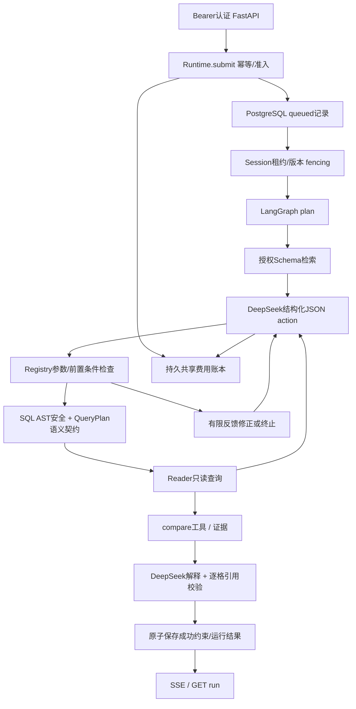

# InsightFlow V2 实际架构

V1 代码与原30题回归保留。默认启动 scripts/serve.sh 已指向 insightflow.v2.api:app。
这是一个有约束的单 Agent，不是多 Agent，也不承诺任意自然语言或生产级隔离。

## 真实模块与数据流
- api.py:create_app：认证来自 Authorization，禁止请求体自报 principal；run/session/SSE/取消均检查所有权。
- service.py:Runtime.submit/_run：排队持久化、任务准入、deadline、心跳、关闭。
- store.py:Store：独立 insightflow_runtime 角色，只能访问 agent_runtime 控制表；查询仍使用 Reader。
- graph.py:build_graph：plan → retrieve → action → tool，证据足够后 answer。没有任意Python/shell工具。
- tools.py:Registry.execute：服务端 Pydantic 参数、授权、SQL校验、只读执行与受控比较。
- provider.py:AsyncDeepSeek：复用 httpx.AsyncClient，thinking=max，所有模型尝试都先预留预算。
- semantics.py：明确日期/否定/对比约束与保守SQL契约；不使用参考SQL替代真实模型生成。

## 状态与一致性
Run 状态：queued → running → succeeded/failed/cancelled/interrupted；已终结记录不能重新完成。
澄清和拒绝是成功完成处理的 disposition，不是 SQL 执行成功。
旧 loopback 模式的 session_id 绑定 principal。internal-pilot 模式使用可信 tenant/principal 派生内部会话作用域，不同主体可使用相同外部会话名称而不共享历史。
同会话按 runs.sequence 顺序领取，数据库短事务锁住Session行；active_run、lease_owner、lease_until
控制跨进程独占，完成时核对所有者、有效租约与 base_version。租约判断使用数据库时钟。
新约束与成功结果在同一事务写入；失败、取消和未经验证的答案不更新可信事实。
会话仅保留4条成功摘要；没有私有思维链。不同会话没有全局串行锁。
模型网络调用期间不占用数据库事务/连接。

## 计划、记忆与版本守卫 · 2026-10-20

进入工具前核对显式年份、退款口径和日期范围；新会话不得由模型擅加未请求的日期/地区。明确纠正覆盖旧条件，全国范围清除地区条件，主数据查询清除无关订单时间/商品地区。受支持的成功约束仍由原事务保存；这不是完整的来源、确认和撤销生命周期。

versions.py 集中定义 pilot-graph-v2-review20261020 与 insightflow-agent-v4-20261020。Store 在重新排队前拒绝旧工作流恢复，图节点也在模型/工具前拒绝版本不符；不修改旧 Checkpoint 或 resume_count。部署前排空/停止旧 API 实例，尚无按入队版本路由的新旧 Worker 混跑协议。[实现与测试](review-20261020/IMPLEMENTATION.md)。

## 并发与资源
默认每进程 active_limit=8、模型并发2、业务DB并发4，均有排队超时。
运行库池和业务Reader池分别有界。本地信号量之外，当前试点使用 PostgreSQL 共享 provider/model/tenant 许可，限制连接到同一控制库的进程；未知请求保留许可一段不确定窗口，不能保证窗口之后的供应商实际在途数量。
同会话等待不会跨越请求总deadline；过载为429，幂等内容冲突409，越权统一404。
HTTP端到端实测包含控制表事务，因此明显慢于V1轻量服务；不能称为吞吐优化。

## 取消、幂等、崩溃
总时间使用单调时钟，自提交前开始；HTTP重试不会重置deadline。
/chat断连、SSE断连或显式取消会取消异步模型请求；SQL线程通过Cancellation回调取消借用连接，
回调寿命受保护，不能误取消下一借用者。DB超时是独立兜底。
幂等作用域 principal+key；请求哈希包含session+question。并发重复只创建一次；内容不同409。
TTL只释放过期终态的幂等键，历史记录不会被悄悄删除；重放返回原终态，不重新计费。
当前试点由 AsyncPostgresSaver 持久化 Graph 状态；Mock 可在权限和版本检查后恢复同一 Run。未启用可恢复路径的过期运行仍中断；不自动重放结果未知的付费请求。Exactly-once 不成立。
启动及周期reaper处理失联记录；队列失联到deadline后标中断。不会恢复未验证答案。
关闭先持久化排队/运行取消，再等待清理、关闭客户端及连接池。

## 可观测与安全边界
OpenTelemetry SDK真实采集有界进程内Span（最多2000），按run关联；/trace有所有权检查。
这不是已部署的外部Collector；进程重启Span丢失，PostgreSQL阶段事件保留。
Prometheus只用固定阶段/状态/池标签，包含队列、模型、SQL、工具、重试、Token、未知Usage、费用预留和池等待。
request/run标识只用于Trace与事件，不作指标标签。日志不记录Prompt、Key、密码或业务原始行。
旧 loopback 模式共享合成业务数据。internal-pilot 模式启用可信租户上下文与 FORCE RLS，禁止请求体或模型授予身份；仍没有 OIDC/SSO 或完成验收的生产运维系统。
