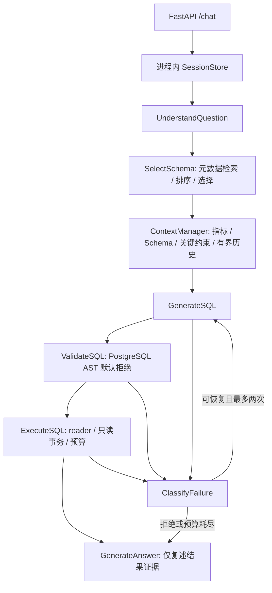
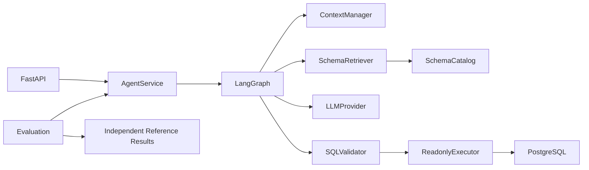
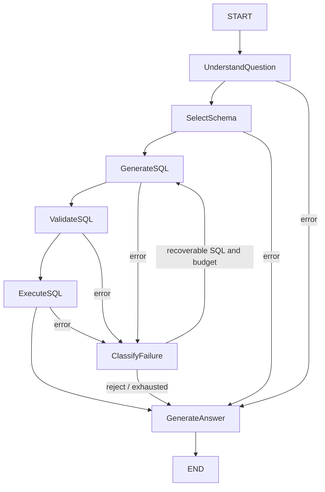
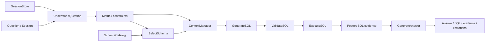

# InsightFlow 架构

使用真实 langgraph.graph.StateGraph.compile/invoke，不是自制同名包装。
UnderstandQuestion/SelectSchema 失败直接进入失败回答；
GenerateSQL/ValidateSQL/ExecuteSQL 的可恢复错误才允许重试。
基础 Day1 两节点图仍保留测试，完整图由 AgentService 使用。

State 在 agent/state.py，包含 question、session_id、request_id、
conversation_context、selected_tables、retrieved_context、generated_sql、
validation_result、query_result、final_answer、error、retry_count，以及结构化计划、
历史、预算与 trace。节点返回字典更新，不修改全局 State。
工具 list_tables/get_table_schema/get_metric_definition/execute_readonly_sql 有校验；
工具日志只记录关联 ID、节点、工具、耗时与错误类型，不记录原始结果或凭据。

Schema 来自允许 business 表的真实元数据；指标来自人工定义。
Mock 只做确定性语义与 SQL 生成，不读取 evaldata 或最终答案。
数据库始终真实执行。DeepSeek 使用官方 OpenAI-compatible SDK，JSON 模式与 Pydantic 严格解析。
最终回答不用自由生成的财务叙述，只输出已执行结果与限制，避免无证据金额和因果声称。

数据库 owner 仅迁移/Seed；reader 执行分析。Graph 不拥有管理员连接。
API 默认 127.0.0.1、无认证，适合本地演示。没有 Redis、额外 Scheduler、
长期记忆、向量库或多 Agent 系统。

官方参考：
[LangGraph](https://reference.langchain.com/python/langgraph/graph/)；
[Psycopg 事务](https://www.psycopg.org/psycopg3/docs/basic/transactions.html)；
[SQLGlot](https://sqlglot.com/)；
[DeepSeek Chat API](https://api-docs.deepseek.com/api/create-chat-completion/)；
[FastAPI 测试](https://fastapi.tiangolo.com/tutorial/testing/)。

## Architecture Diagram

## Agent State Transition

## Data Flow

