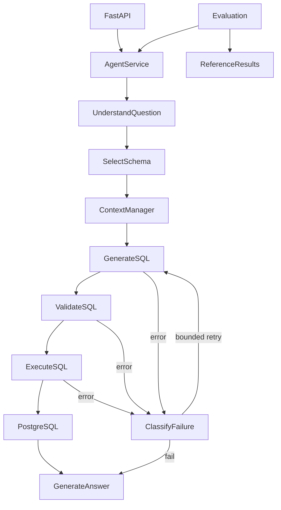

# InsightFlow 最终工程验收
实际执行 2026-10-17；Day1–12 是任务书阶段名称，不虚构未来执行日期。

## 工程概览
- 项目：~/projects/insightflow-data-agent
- GitHub：https://github.com/Loz888/insightflow-data-agent （Private）
- Python 3.12.3；LangGraph 1.2.16、FastAPI 0.143.3、psycopg 3.3.6、
  SQLGlot 30.23.0、Pydantic 2.14.1、pytest 9.1.1、OpenAI SDK 3.33.0。
- 锁定记录 requirements.lock，pip check 与真实导入运行通过。
- 已提交文档基线：5486d59；Day12 代码快照和真实 CI 结果将在推送后补充。
- 状态：本地工程 PASS；远程 CI PENDING，不提前宣称远程验收成功。



## 核心模块树
```text
src/insightflow/
  api/ app.py routes.py schemas.py
  agent/ state.py graph.py nodes.py routing.py service.py tools.py cancellation.py
  llm/ base.py mock.py deepseek.py
  retrieval/ schema_catalog.py retriever.py glossary.py
  context/ manager.py session.py
  database/ connection.py metadata.py validator.py executor.py errors.py
  evaluation/ runner.py scorer.py report.py failure.py real_model.py ablation.py performance.py
  config.py observability.py
migrations/ 001_business_schema.sql ... 004_reader_restriction.sql
scripts/ init_db.sh admin_bootstrap.py seed_data.py demo_mock.sh demo_deepseek.sh
         accept.sh accept.py ci_init.py scan_secrets.py
tests/ 原有所有模块 + 模型/消融/可靠性/观测/扫描负向测试
evaldata/ questions.json expected_results.json retrieval_labels.json
          real_model/ ablation/ performance/ final/
docs/ LEARNING_GUIDE.md architecture.md metrics.md sql-security.md
      real-model-evaluation.md retrieval-ablation.md context-evaluation.md
      security-review.md performance.md
reports/ preflight.md day1.md ... day12.md FINAL_ACCEPTANCE.md
.github/workflows/ci.yml
```

## 功能验收
| 模块 | 实际证据与边界 |
| --- | --- |
| LangGraph | 真实 StateGraph/条件边/返回更新，最大两次 SQL 修正 |
| SQL Execution | 真实 PostgreSQL；非 Owner Reader、只读事务、强制 AST 与预算 |
| Retrieval | 元数据/术语排序、选择、FK 闭合与 Prompt 注入；独立 Recall@5 |
| Context | 继承/覆盖/指标切换/增长/错误历史/隔离；仅进程内短期记忆 |
| SQL Security | DML/DDL/CTE/系统表/函数/引号/资源/权限与函数重载真实测试 |
| Evaluation | 独立参考结果、等价 SQL 结果比较、证据与语义/上下文分开判定 |
| API | Pydantic 输入/输出；真实回环健康/Schema/多轮 HTTP；断连信号与 DB 取消 |
| Reliability | 连接/超时/API/坏响应/检索/Context/Session 故障；不伪造数据 |

## 数据库与指标
两个专用合成库 insightflow_dev/test，每库 100 客户、30 商品、500 订单、
1001 明细、165 退款；固定 seed=20261020、参考时间 2026-10-01 UTC、CNY。
NUMERIC/Decimal、主外键/CHECK/索引，重置式 Seeder 可重复。
退款订单率与金额率分开，按订单时间批次，退款与明细各自聚合，避免 JOIN fan-out。
reader 仅五表 SELECT，无未来表默认授权，不使用 superuser/owner 执行 Agent SQL。

## 测试结果
**135 PASS / 0 FAIL / 0 SKIP / 0 ERROR**。
其中单元 55，真实数据库集成 80。
计数为 pytest 参数化条目；业务评测和并发请求另计。
Ruff 静态/格式、compileall、pip check、Mock Demo 与专用 DB 权限检查均通过。
没有配置额外 mypy 类型检查器，不虚称执行了它。
原测试未删除，原 30 Ground Truth 文件 SHA-256 完全不变。
Day11 干净源码/新 venv 重装锁依赖、迁移 Seed 重放、实际 HTTP 多轮通过；
该本地复现复用专用测试库，不冒称全新操作系统安装。
远程 CI 尚待实际运行；其 PostgreSQL 由临时 service 从空集群初始化。

## 最终 Agent Evaluation
- 30 独立案例，30 唯一 RunID：10 基础、10 JOIN/聚合、5 复杂指标、5 多轮。
- SQL Execution 30/30，Result Accuracy 30/30，Answer Groundedness 30/30，E2E 30/30。
- Exact Match 8/30；不以文本差异否决等价结果。
- P50 10.384 ms，P95 22.428 ms，平均 SQL 修正 0。
- Mock 策略调用 70（含 5 个前序轮次）；真实 API 未调用，Token 未知/null。
- Full 本轮无失败，failures.json 如实为空；消融另有 10 个实际失败，
  错误但可执行 SQL 的负向评分测试也保留。
- REAL_MODEL_EVALUATION = NOT_RUN，不能把 Mock 正确率称为 DeepSeek 能力。
- 最终评测不要求得满分才写报告，不改 Ground Truth 追求全绿。

实际记录：[最终评测](../evaldata/final/report.md)、[逐案](../evaldata/final/runs.jsonl)、
[失败](../evaldata/final/failures.json)、[真实模式 NOT_RUN](../evaldata/real_model/report.md)。

## Retrieval / Context 消融
120 次真实运行：Baseline/RetrievalOnly 各 25/30，ContextOnly/Full 各 30/30。
Recall@5 来自独立参考 SQL 物理表标签，原较宽业务关联不作为自证答案。
Mock SQL 不读 Schema 文本，因此不能从此证明真实 LLM RAG 收益。
时间/地区/指标的确定性继承被真实验证，但不是模型通用对话能力。
[检索](../docs/retrieval-ablation.md) · [上下文](../docs/context-evaluation.md) ·
[原始观测和失败](../evaldata/ablation/report.md)。

## Performance
Day10 实际 512 个唯一请求，4 档并发各 128，全部成功。
AgentService.run 入口，不是 HTTP 或真实模型吞吐；暖数据、小样本。
并发 1/2/4/8 的 P95 分别 14.484/28.744/53.063/255.438 ms；
吞吐分别 86.71/80.91/83.69/82.88 req/s。
全局串行使排队增长；SQL 节点均值约 7ms，并无数据库是唯一瓶颈的证据。
P50/P95/P99 为 nearest rank，不能作为生产 SLA。
环境/硬件/逐请求阶段/三条 EXPLAIN ANALYZE BUFFERS 均有原始记录。
[性能分析](../docs/performance.md) · [观测](../evaldata/performance/report.md)。

## Security 与边界
AST 默认拒绝、Reader 权限、只读事务、超时与输出/计划预算并存。
普通白名单函数明确限定 pg_catalog，真实重载与嵌套函数测试通过。
Prompt 注入不能提高权限；原始业务数据在负向攻击前后摘要不变。
取消回调不越过借用连接寿命，不取消下一请求；失败/取消不保存可信事实。
未知工具异常 error_kind 漏标 Bug 在 Day12 修正并新增回归，仅改观测语义。
Trace 只含关联标识/哈希 Session/模型/阶段/工具/实测时间/错误分类/重试数。
本地 .env、真实 Key/密码、Dump、日志、venv、缓存和私人材料不进入 Git。
脚本扫描实际文件、暂存 blob 与全部可达历史，匹配只输出文件/类别；
CI 内固定密码仅为销毁式临时容器夹具，不是本机数据库凭据。
[审查与实际故障证据](../docs/security-review.md) · [测试节点](reliability.json)。

不防御所有 PostgreSQL/解析器漏洞、侧信道或不可信 DB 管理员。
计划预算非 OS 沙箱；在途同步 LLM 取消受单次超时，DB 取消尽力而为且有独立超时。
无认证/租户授权/生产安全保证，只能回环演示。

## 交付与学习顺序
[README](../README.md) · [八章学习指南](../docs/LEARNING_GUIDE.md) ·
[架构](../docs/architecture.md) · [机器验收](acceptance.json)。
十步：Request → State → Nodes → Retrieval → Context → Validator →
Executor → Evaluation → Performance → 成功/失败/取消整链路。
每步的真实路径、函数、输入/输出/State 更新/失败原因都在学习指南。

## Remaining Limitations / 评价
受控中文指标和合成数据；Schema 启动快照；会话重启丢失、全局串行；
没有持久长期记忆、多租户、向量库、多 Agent、复杂前端或分布式平台。
真实模型/费用未验证；上下文 Token 为估算。
当前本地证据满足基础、工程完整与可复现要求；完整工程证据等级待真实 CI 后判定。
冻结新增功能，不把 Roadmap 冒充已完成能力。
